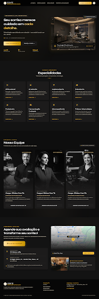

# 🌌 Con Te Odontologia Aura Sculpt — Landing Page

> Versão Aura Sculpt (Dark Velvet / Champagne Aurum & Syne) desenvolvida no **Google Stitch**.



---

## 🌟 Sobre a Versão Aura Sculpt
- **Estilo Visual:** Aura Sculpt (Minimalismo Escultural, acabamento metalúrgico champanhe `#FFE7A0`, ouro queimado `#D4A017`, superfícies em preto aveludado `#131313`).
- **Tipografia:** *Syne* (títulos esculturais e arquitetônicos) + *Hanken Grotesk* (legibilidade contemporânea).
- **Projeto Stitch:** `projects/16551316860879306953`
- **Screen ID:** `ea1a26b2e9524e4f8b52d011cb0dc8cf`

## 📁 Estrutura de Arquivos
```
conte-odontologia-aura/
├── index.html
├── DESIGN.md
├── README.md
└── assets/
    └── images/
        ├── logo.png
        ├── clinic-suite.jpg
        ├── specialist-1.jpg
        ├── specialist-2.jpg
        ├── specialist-3.jpg
        ├── reception-lounge.jpg
        └── page-preview.png
```
